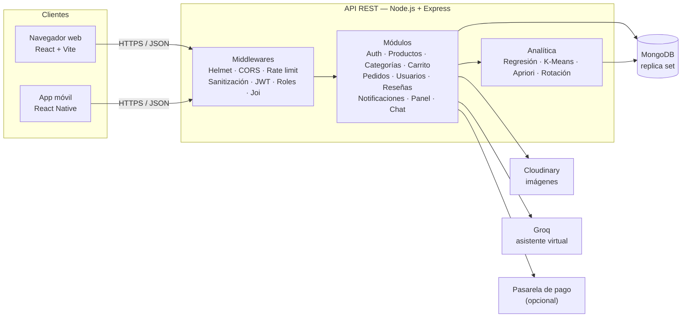
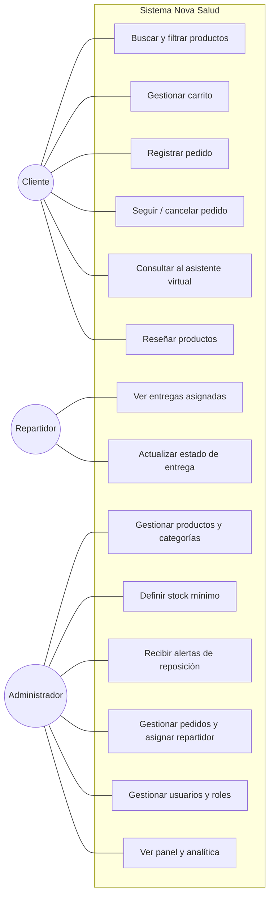
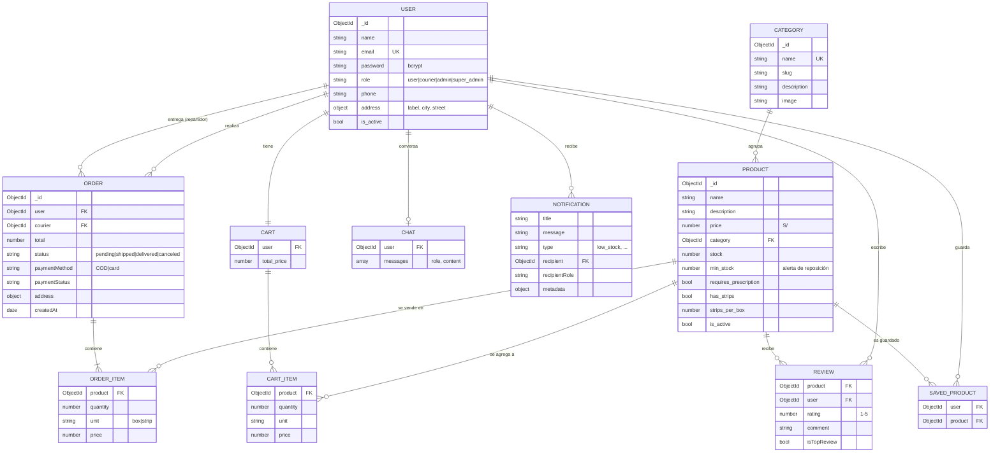
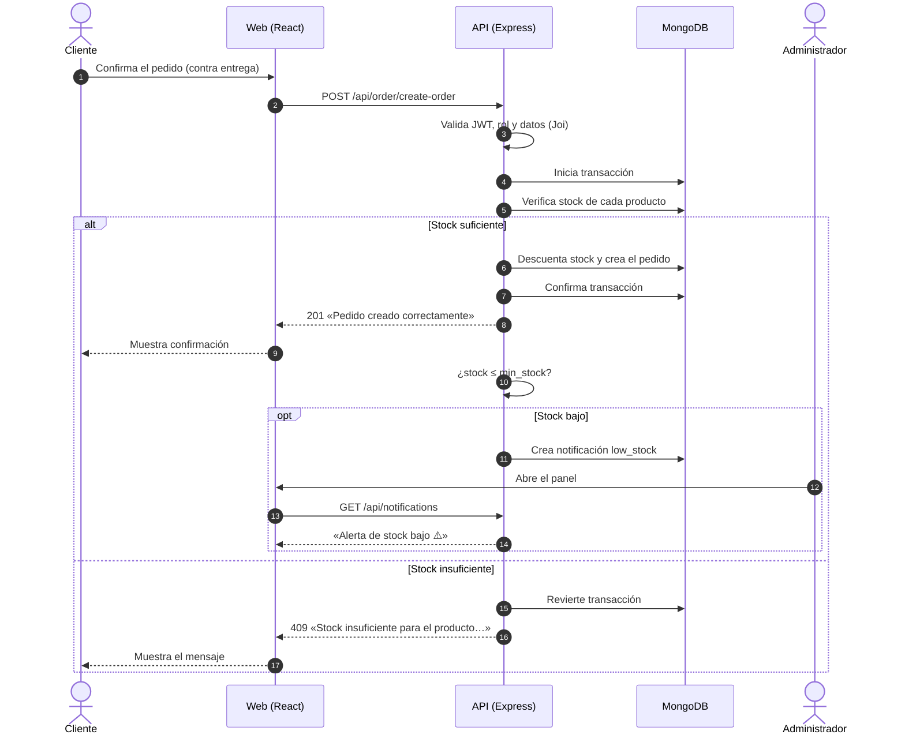
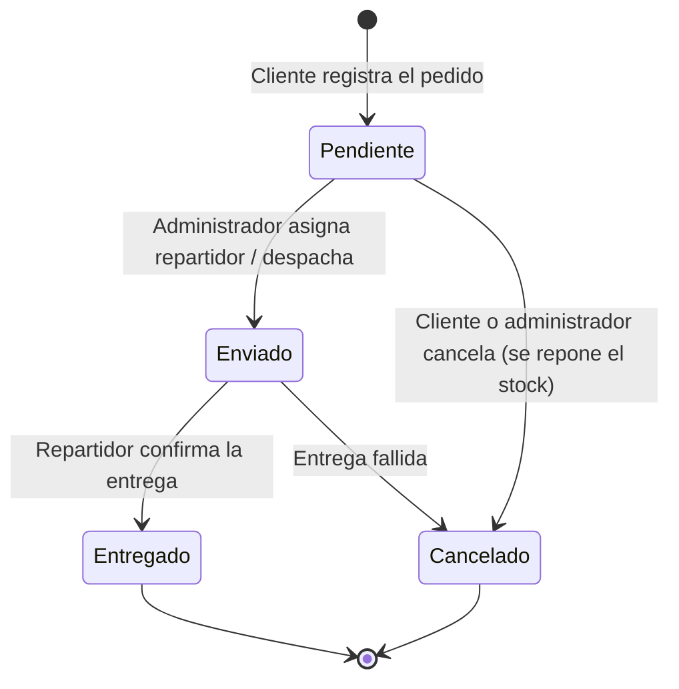
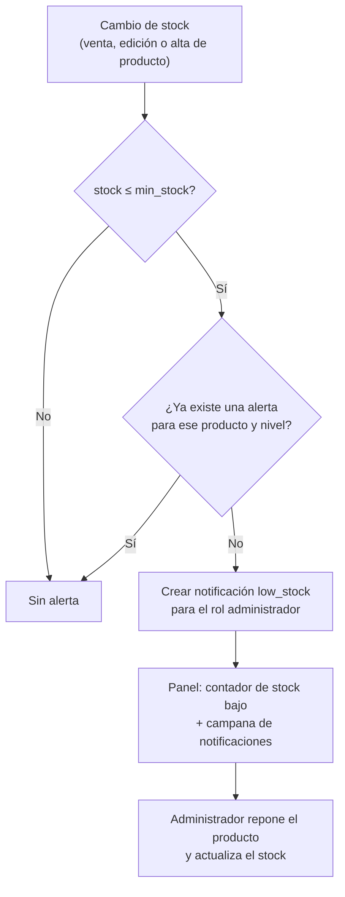
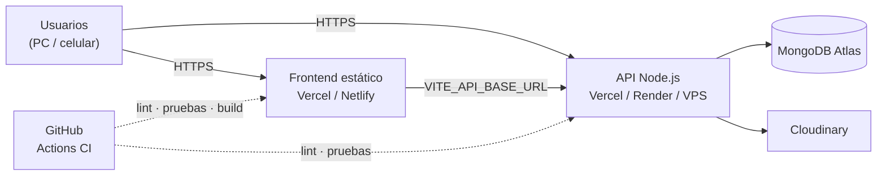

# Propuesta de solución — Botica «Nova Salud»

**Curso:** Fullstack Developer — Trabajo final (PIAD-527)
**Tema:** Implementación de un software web de gestión de inventario y venta de una botica

> Las preguntas guía del enunciado mencionan a «FarmaPlus»; se responden aplicadas al caso práctico de la botica **Nova Salud**.

---

## Índice
1. [Caso y objetivo](#1-caso-y-objetivo)
2. [Diagnóstico: desafíos operativos (pregunta 1)](#2-diagnóstico-desafíos-operativos-pregunta-1)
3. [Solución propuesta: características del software (pregunta 2)](#3-solución-propuesta-características-del-software-pregunta-2)
4. [Impacto en el desabastecimiento y el servicio (pregunta 3)](#4-impacto-en-el-desabastecimiento-y-el-servicio-pregunta-3)
5. [Beneficios adicionales y competitividad (pregunta 4)](#5-beneficios-adicionales-y-competitividad-pregunta-4)
6. [Métricas de evaluación (pregunta 5)](#6-métricas-de-evaluación-pregunta-5)
7. [Cumplimiento de las condiciones del caso](#7-cumplimiento-de-las-condiciones-del-caso)
8. [Diagramas](#8-diagramas)
9. [Normas técnicas, seguridad y salud en el trabajo y medio ambiente](#9-normas-técnicas-seguridad-y-salud-en-el-trabajo-y-medio-ambiente)
10. [Plan de implementación](#10-plan-de-implementación)

---

## 1. Caso y objetivo

La botica Nova Salud, ubicada en una zona comercial de alta demanda, creció en número de clientes pero mantiene el **control de stock y la atención de forma manual**. Esto provoca errores, **desabastecimientos frecuentes** y **largos tiempos de espera**.

**Objetivo:** implementar un software web que gestione de forma centralizada y automatizada el **inventario**, las **ventas** y la **atención al cliente**, con actualización del stock en tiempo real, alertas automáticas de reposición, registro de ventas y una interfaz que agilice la atención.

---

## 2. Diagnóstico: desafíos operativos (pregunta 1)

> *¿Cuáles son los principales desafíos operativos que enfrenta la botica debido a la falta de un sistema de gestión de inventarios automatizado?*

| Desafío | Causa en el proceso manual | Consecuencia |
|---|---|---|
| **Desabastecimiento** | Nadie sabe con exactitud cuándo un producto llega a un nivel crítico; la reposición se decide «a ojo». | Ventas perdidas y clientes que se van a la competencia. |
| **Errores de inventario** | Registro en cuadernos/Excel, conteos manuales y doble registro. | Diferencias entre stock físico y registrado; compras innecesarias o faltantes. |
| **Largos tiempos de espera** | El personal busca el producto, verifica el stock y calcula el precio manualmente. | Colas, mala experiencia y menor capacidad de atención en horas punta. |
| **Sin trazabilidad de ventas** | Las ventas no quedan registradas por producto, fecha y cliente. | No hay datos para decidir compras, promociones ni turnos. |
| **Control de medicamentos con receta** | Depende de la memoria del personal. | Riesgo sanitario y legal. |
| **Productos vencidos o de baja rotación** | No se mide la velocidad de venta. | Capital inmovilizado y mermas. |
| **Seguridad de la información** | Datos de clientes en papel o archivos sin protección. | Pérdida o filtración de datos personales. |

---

## 3. Solución propuesta: características del software (pregunta 2)

> *¿Qué características específicas debe incluir el software web para atender las necesidades de control de stock y atención al cliente?*

Se implementó un sistema web **MERN** (MongoDB, Express, React, Node.js) con una app móvil complementaria en React Native.

### 3.1 Control de stock
- **Catálogo de productos y categorías** con precio, stock, imagen, presentación (caja / blíster) y si **requiere receta**.
- **Actualización del stock en tiempo real:** cada pedido descuenta el stock dentro de una **transacción** de base de datos; si dos clientes compran el último producto a la vez, solo uno lo logra. Al cancelar un pedido el stock se repone.
- **Stock mínimo por producto** (`min_stock`, por defecto 10) configurable desde el panel.
- **Módulo de alertas de reposición:** cuando un producto queda en o por debajo de su stock mínimo se genera automáticamente una **notificación** para el administrador («Solo quedan 4 unidades (mínimo: 10). Programe la reposición.»). El panel muestra el contador de productos con stock bajo.
- **Análisis de rotación:** unidades vendidas en 30 días, velocidad diaria y **días restantes** antes de agotarse, con estados *Saludable / Advertencia / Reponer de inmediato / Agotado*.

### 3.2 Registro de ventas
- Carrito con venta por **caja o blíster**, validación de stock y cálculo automático del total en **soles (S/)**.
- Pedido con dirección, teléfono y método de pago (**contra entrega** o tarjeta).
- Ciclo de vida del pedido: *Pendiente → Enviado → Entregado* o *Cancelado*, con asignación a **repartidor**.
- Historial de pedidos para el cliente y gestión completa (filtros, búsqueda, cambio de estado) para el administrador.

### 3.3 Atención al cliente
- **Buscador** por nombre o dolencia, filtros por categoría, precio, receta, disponibilidad y presentación.
- **NovaBot**, asistente virtual con IA que responde en español usando datos reales: stock, precio, carrito y estado de pedidos.
- Reseñas y calificaciones, lista de favoritos y perfil del cliente.
- Interfaz responsiva (celular, tablet, PC) con modo claro/oscuro.

### 3.4 Gestión y seguridad
- **Roles:** cliente, repartidor, administrador y super administrador.
- **Panel de administración** con ingresos, pedidos, clientes, alertas y analítica.
- Seguridad descrita en la [sección 9](#9-normas-técnicas-seguridad-y-salud-en-el-trabajo-y-medio-ambiente).

---

## 4. Impacto en el desabastecimiento y el servicio (pregunta 3)

> *¿De qué manera la implementación del software puede impactar en la reducción del desabastecimiento y la mejora del servicio al cliente?*

**Reducción del desabastecimiento**
1. **Detección temprana:** la alerta se dispara al llegar al stock mínimo, no cuando el producto ya se agotó; el administrador tiene margen para comprar.
2. **Reposición basada en datos:** los *días restantes* indican qué productos se agotarán primero; se prioriza la compra de los de mayor rotación.
3. **Stock confiable:** al descontar automáticamente en cada venta desaparecen los errores de registro manual y las «ventas de productos que no hay».
4. **Pronóstico de demanda:** la regresión lineal sobre las ventas de 30 días proyecta los próximos 7 días para planificar compras.

**Mejora del servicio**
1. **Menos tiempo de atención:** buscar un producto, ver su stock y precio toma segundos en lugar de minutos.
2. **Autoatención:** el cliente consulta disponibilidad, compra y hace seguimiento de su pedido desde la web o el celular, sin hacer cola.
3. **Respuesta inmediata 24/7** con el asistente virtual para consultas frecuentes.
4. **Información veraz:** el cliente sabe antes de ir a la botica si el producto está disponible.

---

## 5. Beneficios adicionales y competitividad (pregunta 4)

> *¿Qué beneficios adicionales, aparte del control de inventarios, podría ofrecer el software para incrementar la competitividad?*

- **Canal de venta en línea con delivery**, que amplía el alcance más allá de la zona comercial.
- **Segmentación de clientes (K-Means / RFM):** identifica clientes VIP, activos y en riesgo de abandono para campañas de fidelización.
- **Combos y ventas cruzadas (Apriori):** descubre productos que se compran juntos (p. ej. antigripal + vitamina C) para promociones.
- **Reseñas y calificaciones** que generan confianza y reputación.
- **Asistente virtual** como diferenciador frente a boticas tradicionales.
- **Toma de decisiones con datos:** ingresos, tendencias y productos más vendidos en un solo panel.
- **Escalabilidad:** la arquitectura permite agregar sucursales, facturación electrónica o integración con proveedores.

---

## 6. Métricas de evaluación (pregunta 5)

> *¿Qué métricas se pueden utilizar para evaluar la efectividad del software en mejorar los tiempos de respuesta y reducir los errores de inventario?*

Se recomienda medir una **línea base** antes de implementar (1–2 semanas de registro manual) y comparar mensualmente.

| Métrica | Fórmula | Meta sugerida | Fuente en el sistema |
|---|---|---|---|
| **Tiempo promedio de atención** | Σ (fin − inicio de atención) / nº de atenciones | −50 % frente a la línea base | Hora de creación del pedido / registro en caja |
| **Tiempo de respuesta de consultas** | Tiempo entre la pregunta y la respuesta (chat o mostrador) | < 1 min | Historial del asistente |
| **Exactitud de inventario** | (Productos cuyo stock físico = stock en sistema / productos contados) × 100 | ≥ 98 % | Conteo cíclico vs. `stock` |
| **Tasa de quiebre de stock** | (Productos agotados / productos activos) × 100 | < 2 % | Estado *Agotado* en Inventario |
| **Pedidos rechazados por falta de stock** | Pedidos rechazados / pedidos intentados × 100 | Tendencia a 0 | Error «Stock insuficiente» |
| **Tiempo de reacción a alertas** | Fecha de reposición − fecha de la alerta | < 48 h | Notificaciones `low_stock` |
| **Días de cobertura** | Stock actual / velocidad de venta diaria | 15–30 días en productos clave | Pestaña Rotación de inventario |
| **Pedidos atendidos por hora** | Pedidos entregados / horas de atención | En aumento | Panel / pedidos |
| **Tasa de cancelación** | Pedidos cancelados / pedidos totales × 100 | < 5 % | Estados de pedido |
| **Satisfacción del cliente** | Promedio de calificaciones (1–5) | ≥ 4.5 | Reseñas |

---

## 7. Cumplimiento de las condiciones del caso

| Condición / requisito | Cómo se cumple |
|---|---|
| Accesible desde dispositivos web | Aplicación web responsiva (React + Tailwind) y app móvil (React Native). |
| Seguridad en los datos | bcrypt, JWT en cookie `httpOnly`, roles, Helmet, rate limiting, sanitización NoSQL, HPP, CORS restringido, validación Joi/Zod. |
| Módulo de alertas para reposición de bajo stock | `min_stock` por producto + notificación automática al administrador + contador y análisis en el panel. |
| Interfaz intuitiva que reduzca el tiempo de atención | Búsqueda y filtros, carrito, compra en pocos pasos, asistente virtual, estados claros. |
| Gestión centralizada de inventario, ventas y atención | Una sola API y una sola base de datos para todos los módulos. |
| Sistema de registro de ventas | Pedidos con detalle, total, cliente, estado, repartidor y fecha. |
| Optimizar la gestión interna y reducir errores | Descuento automático y transaccional del stock, validaciones, analítica de rotación. |

---

## 8. Diagramas

### 8.1 Arquitectura de la solución

### 8.2 Casos de uso

### 8.3 Modelo de datos (colecciones de MongoDB)

**Correspondencia con el modelo relacional inicial** ([`database/nova_salud.sql`](../database/nova_salud.sql)):

| Tabla SQL | Colección / campo en MongoDB |
|---|---|
| `roles` | Campo `role` de `users` (enumeración) |
| `usuarios`, `clientes` | `users` (clientes = rol `user`; personal = `courier`, `admin`, `super_admin`) |
| `categorias` | `categories` |
| `productos` (`stock_actual`, `stock_minimo`, `requiere_receta`) | `products` (`stock`, `min_stock`, `requires_prescription`) |
| `ventas` + `detalle_venta` | `orders` con `items` embebidos |
| `proveedores`, `ingresos_inventario`, `detalle_ingresos` | Se reponen con la edición de stock del producto; módulo de compras a proveedores propuesto como mejora (ver sección 10) |

### 8.4 Secuencia: registro de venta y alerta de reposición

### 8.5 Estados del pedido

### 8.6 Flujo del módulo de alertas

### 8.7 Despliegue sugerido

---

## 9. Normas técnicas, seguridad y salud en el trabajo y medio ambiente

**Normas técnicas y buenas prácticas de desarrollo**
- Arquitectura por capas (rutas → controladores → servicios → repositorios → modelos) y API REST documentada con **Swagger/OpenAPI** (`/api-docs`).
- **149 pruebas unitarias** (Vitest), lint (ESLint) e integración continua con GitHub Actions.
- Control de versiones con Git y ramas de funcionalidad.

**Seguridad de la información** (Ley N.° 29733, Ley de Protección de Datos Personales)
- Contraseñas cifradas con bcrypt; nunca se almacenan en texto plano.
- Autenticación JWT en cookie `httpOnly` (no accesible desde JavaScript) y autorización por roles.
- Helmet (cabeceras seguras), límite de solicitudes contra fuerza bruta, sanitización contra inyección NoSQL, protección HPP y CORS limitado a los orígenes autorizados.
- Validación estricta de todas las entradas (Joi en el servidor, Zod en el cliente).
- Las claves y credenciales viven en variables de entorno (`.env`), fuera del repositorio.

**Seguridad y salud en el trabajo** (Ley N.° 29783)
- Menos tareas repetitivas de conteo y registro manual, lo que reduce la fatiga y la carga del personal en horas punta.
- Interfaz con modo oscuro y diseño legible para reducir la fatiga visual.
- Durante el desarrollo: pausas activas, ergonomía del puesto de trabajo y buena iluminación.

**Medio ambiente**
- Sistema digital que **reduce el uso de papel** (cuadernos de stock, notas de pedido).
- El control de rotación y del stock mínimo evita **vencimientos y mermas**, y por tanto medicamentos desechados.
- Despliegue en la nube con infraestructura compartida, sin servidores físicos propios encendidos permanentemente.

---

## 10. Plan de implementación

| Fase | Actividades | Entregable |
|---|---|---|
| 1. Análisis | Levantamiento de procesos, línea base de métricas | Diagnóstico (sección 2) |
| 2. Diseño | Arquitectura, modelo de datos, prototipos | Diagramas (sección 8) |
| 3. Desarrollo | API, web, móvil, pruebas | Este repositorio |
| 4. Carga inicial | `npm run seed`, registro del catálogo y stock real, definición de stock mínimo | Base de datos inicial |
| 5. Capacitación | Uso del panel, alertas y pedidos | Personal capacitado |
| 6. Puesta en marcha | Despliegue y monitoreo de métricas | Sistema en producción |

**Mejoras futuras propuestas:** módulo de proveedores e ingresos de mercadería con lote y fecha de vencimiento (tablas `proveedores` e `ingresos_inventario` del modelo inicial), boleta/factura electrónica SUNAT, pago con Yape/Plin o Niubiz y reportes exportables a Excel/PDF.
